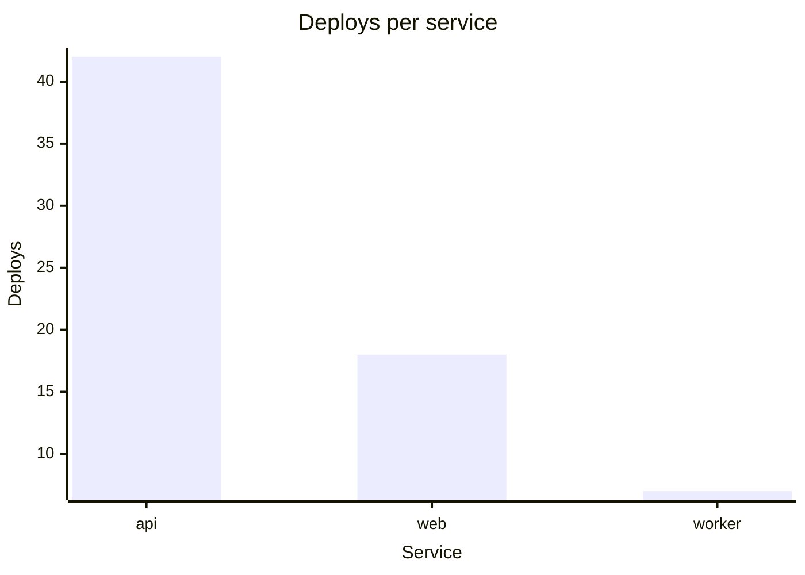

# Slack reply rendering

A Slack reply can hold more than prose. The renderer draws some content as a
block and leaves the rest as text.

## What reaches a block

| Write this | Slack draws |
| --- | --- |
| a Markdown table | a table block. You need no fence. |
| a `mermaid` fence | a chart, from `pie` or from `xychart-beta` |
| a `vega-lite` fence | a chart, from a `bar`, `area`, `line` or `arc` mark |
| a `blockkit` fence | the Block Kit blocks as written |
| a `slack-raw` fence | the source, shown on purpose |
| any other fence | the source |

The fence language is the whole request. There is no marker to add beside it, no
second word in the info string, and no reply-level switch.

`mermaid` and `vega-lite` are portable languages. Other renderers read them too.
`blockkit` is Slack only.

## Declined fences

The renderer declines a shape it does not recognise and draws no approximation
of it. A mermaid flowchart, a sequence diagram, a Gantt, or a Vega-Lite mark
that does not map all arrive as the source you wrote. A decline costs that one
fence. A table or a chart beside it still draws.

A message-level limit behaves differently. When a message holds a third chart or
too many blocks, the whole message posts as plain text.

## Chart limits

Check these before you design a chart.

| Limit | Value |
| --- | --- |
| charts in one message | 2 |
| pie segments | 12 |
| series in a bar, area or line chart | 12 |
| x-axis categories | 20 |
| chart title | 50 characters |
| segment, category and series labels | 20 characters |

The renderer shortens a title or a label longer than its limit, and the chart
still draws. Two labels that become identical after that decline the chart,
because Slack matches each data point to its category by label.

Every series must hold one value for each category. A gap declines the chart,
and the renderer does not invent a zero for it. In Vega-Lite the `color` channel
splits the rows into series, so a `color` used for decoration asks for a grid
that is mostly gaps. Give `color` a real second field, or leave it out. A
one-colour bar chart is what a single series looks like.

Every pie value must be above zero.

## Markdown tables

A Markdown table needs no fence and has none of the chart limits. Its cells
show exact values.

Whether a table gets sorting and filtering in the client is an operator setting.
Write the table and let the renderer decide. A column sorts as a number only when
every cell in it is a plain unadorned number.

## mermaid diagrams

`pie` draws a pie chart. `xychart-beta` is the only mermaid diagram that reaches
a bar or line chart. Write `bar` or `line` for the plot. The bare `xychart` alias
also works.

````

````

`xychart-beta` declines a `horizontal` orientation, a numeric x-axis range,
mixed `bar` and `line` plots in one diagram, a value count that disagrees with
the category count, and per-point labels.

mermaid has no area chart. An area chart comes from `vega-lite` or `blockkit`.

## Vega-Lite specs

Four marks map: `bar`, `area`, `line`, and `arc` for a pie. Every other mark
declines.

An `arc` needs both a `theta` channel for the value and a `color` channel for the
label. Slack has nowhere else to get a slice name.

These also decline:

- Keys that make the spec more than one chart: `layer`, `facet`, `repeat`,
  `concat`, `hconcat`, `vconcat`, `spec`, and a `row`, `column` or `facet`
  encoding channel.
- Keys that compute the values: `transform`, and `aggregate`, `bin`, `timeUnit`
  or `stack` on a channel. Aggregate the data yourself and put the results in
  `data.values`.
- A `sort` anywhere but on `x`. On `x`, the renderer reads only an explicit
  array of the categories. `"ascending"`, `"-y"` and a sort object decline,
  because each orders the categories by something that must be computed first.
  An array may name a category the data does not hold, and the renderer skips
  that name. An array that leaves a category out declines.
- Data that is not inline. The renderer reads only `data.values`. A `url`, a
  named source and a generated `sequence` all decline.
- A quantitative `x`. The x-axis is a list of categories. Use `nominal`,
  `ordinal` or `temporal`, and declare the type, because the renderer reads x
  values that are all numbers as quantitative.
- A non-quantitative `y`, which is Vega-Lite's horizontal bar chart. Slack draws
  charts vertically only.
- An encoding channel that is neither read nor inert. Read: `x`, `y`, `color`,
  `theta`. Inert: `tooltip`, `description`, `href`, `key`. Every other channel
  declines.

## Block Kit fences

A `blockkit` fence holds Block Kit JSON and draws it as written. Use it when
neither portable fence says what you mean. Field names, types and their limits
are not in this skill.

The renderer refuses interactive elements by default. These are buttons,
selects, inputs, and anything that has an `action_id`. A reader cannot tell a
block you wrote from a real approval prompt.
